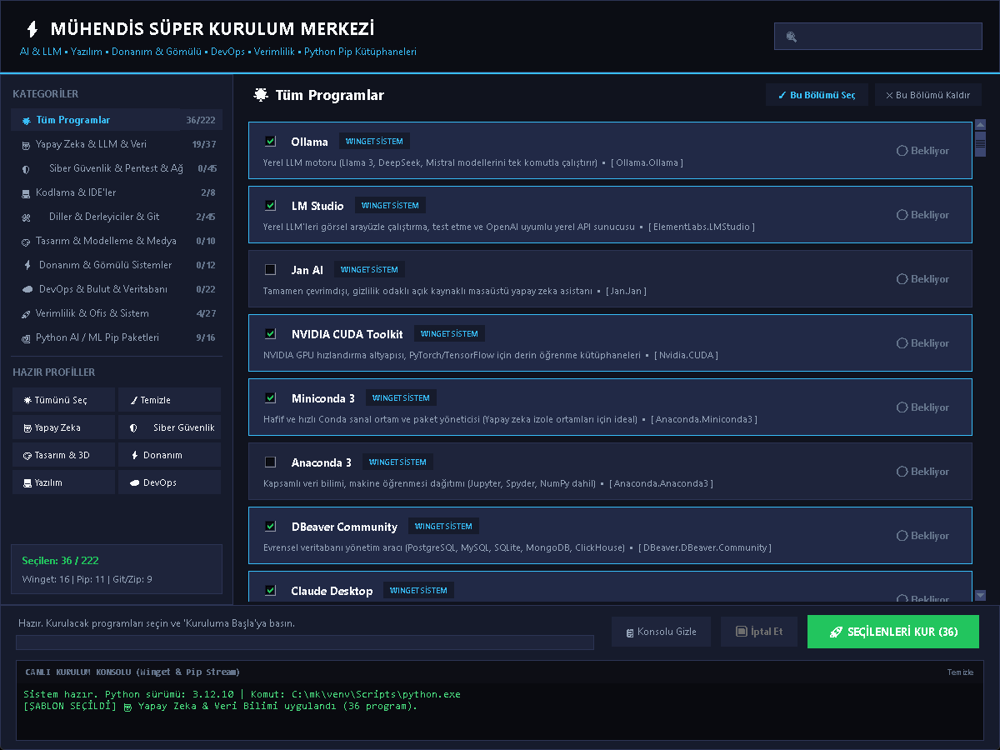

<div align="center">

# Atölye

**Mühendisler için kurulum merkezi.** Araçlarını seç, tek tıkla kur.

   [](https://github.com/MustafaCanDere/atolye/actions)



</div>

## Neden Atölye?

Yeni bir bilgisayar kurarken onlarca siteye girip tek tek program indirmek zaman kaybı. Atölye, mühendislik ve yazılım araçlarını tek pencerede toplar: işaretle, **Seçilenleri Kur**'a bas, gerisini o halletsin.

- **Harici bağımlılık yok.** Sadece standart Python (Tkinter).
- **222 araç, 9 kategori:** yapay zeka, siber güvenlik, yazılım, DevOps, donanım, tasarım ve daha fazlası.
- **Hazır profiller:** Yapay Zeka, Siber Güvenlik, Yazılım, DevOps, Donanım, Tasarım. Tek tıkla bir alanın tüm araçlarını seç.
- **Canlı arama** ve kategori filtresi.
- **Üç kurulum yolu:** Winget (sistem programları), pip (Python paketleri), git (açık kaynak projeler, `requirements.txt` otomatik kurulur).
- **Seçimlerini hatırlar** ve kurulumu canlı konsolda gösterir.

## Hızlı başlangıç

1. Repoyu indir (`Code → Download ZIP`) veya klonla:
   ```bash
   git clone https://github.com/MustafaCanDere/atolye.git
   ```
2. `ATOLYE_BASLAT.bat` dosyasına çift tıkla. Python yoksa Winget ile kurmayı önerir.
3. Programları işaretle veya soldan bir profil seç.
4. **Seçilenleri Kur** butonuna bas.

Terminalden çalıştırmak istersen:

```bash
python atolye.py
```

## Gereksinimler

- Windows 10 veya 11
- [Winget](https://learn.microsoft.com/windows/package-manager/) (Windows 11'de hazır gelir)
- 64-bit Python önerilir. 32-bit Python'da PyTorch ve OpenCV gibi büyük paketler kurulamayabilir.

## Proje yapısı

| Dosya | Görev |
|---|---|
| `atolye.py` | Arayüz ve kurulum motoru |
| `programlar_db.py` | Program, kategori ve profil veritabanı |
| `ATOLYE_BASLAT.bat`, `baslat.bat` | Başlatıcılar |
| `tests/` | Veritabanı tutarlılık testleri |
| `docs/` | Tanıtım sayfası (GitHub Pages) |

## Katkı

Yeni program eklemek veya hata bildirmek için [CONTRIBUTING.md](CONTRIBUTING.md) dosyasına bak. Testleri çalıştırmak için:

```bash
python -m unittest discover -s tests -v
```

## Tanıtım sayfası

`docs/index.html` tek dosyalık bir tanıtım sayfasıdır. GitHub'da **Settings → Pages → Branch: `main` / Folder: `/docs`** seçersen `https://MustafaCanDere.github.io/atolye/` adresinde yayınlanır.

## Sorumluluk reddi

Listede siber güvenlik ve pentest araçları da bulunur. Bunları **yalnızca kendi sistemlerinde veya yazılı izin aldığın ortamlarda** kullan. Kurulan her programın lisansı kendi sahibine aittir. Atölye programların kendisini dağıtmaz, resmî kaynaklardan (Winget, pip, GitHub) kurar.

## Lisans

MIT. Bkz. [LICENSE](LICENSE).
